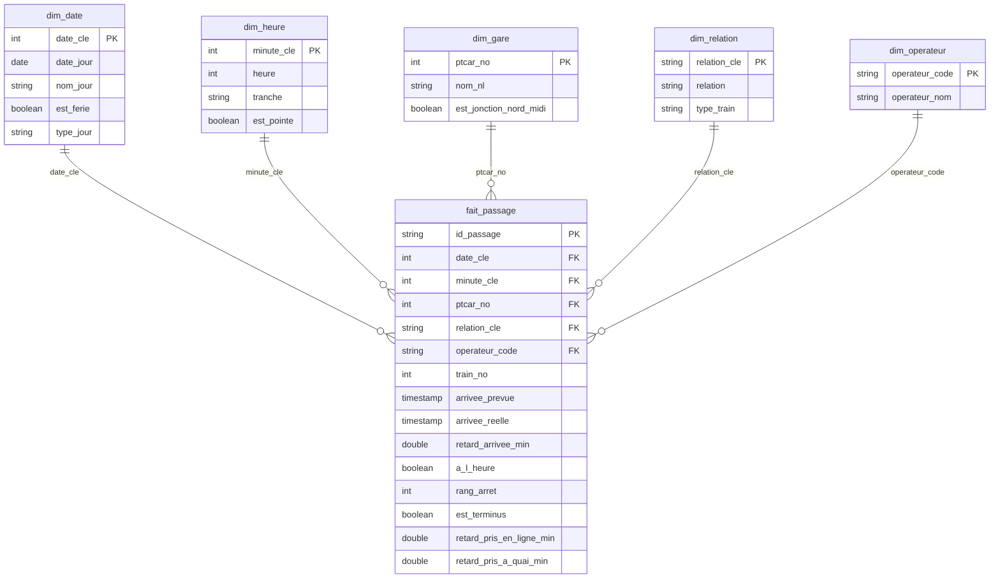

# Ponctualité des trains belges

Un pipeline de données sur Databricks qui transforme les fichiers bruts de ponctualité d'Infrabel en un modèle en étoile et un tableau de bord. Les données couvrent août et septembre 2026 : 4 051 748 passages d'un train à un point du réseau.

Le projet suit l'architecture médaillon. Le bronze charge les CSV avec Auto Loader, le silver type et contrôle les données en PySpark, le gold construit le modèle en étoile en SQL. Un job Lakeflow enchaîne les trois couches dès qu'un nouveau fichier mensuel arrive.

## Ce que montrent les données

- **91,9 % des trains arrivent à leur terminus avec moins de 6 minutes de retard**, sur 208 365 trains : 92,8 % en août et 91,1 % en septembre. Le retard moyen au terminus est de 2,04 minutes.
- **Sur la jonction Nord-Midi, à Bruxelles, les trains perdent du temps.** 90,6 % des arrivées y sont à l'heure, contre 93,4 % sur le reste du réseau. Entre deux points, un train y perd 1 seconde en moyenne, alors qu'il en regagne 5 ailleurs. À quai, il perd 11 secondes, contre 6 ailleurs.
- **Huit des quinze points les moins ponctuels sont en province de Liège.** Le moins ponctuel, Hergenrath, juste avant la frontière allemande, n'a que 69 % d'arrivées à l'heure.
- **Le retard grandit sur les longs trajets.** Il reste autour de 1,6 minute jusqu'au 12e point du trajet, puis monte vers 2 minutes.

## Architecture


Le job `ponctualite_trains_belges` lance les notebooks 02, 03 et 04 l'un après l'autre, puis rafraîchit le tableau de bord. Il démarre dès qu'un fichier arrive dans le volume, et envoie un mail en cas d'échec. Tout tourne sur le calcul serverless, en mode standard : pour un traitement mensuel, quelques minutes de démarrage ne comptent pas, et ce mode consomme moins.

## Les données

- **Source** : [fichiers mensuels des données brutes de ponctualité](https://opendata.infrabel.be/explore/dataset/stiptheid-gegevens-maandelijksebestanden/information/), publiés par Infrabel sous licence CC0.
- **Contenu** : une ligne par passage d'un train à un point du réseau, avec les heures prévues et réelles d'arrivée et de départ, et les retards en secondes.
- **Format** : 22 colonnes, soit les 19 de la documentation plus `CIRC_TYP`, `OP1_COD` et `THOP1_COD`. Les dates s'écrivent `01AUG2026` et les heures `9:59:59`, sans zéro devant.
- **Volume** : 652,4 Mo de CSV pour août et septembre 2026, 642 points du réseau et 211 918 trains-jours.

## Les notebooks

### 01 · Exploration (PySpark)

Le notebook lit les CSV sans rien écrire : profil de chaque colonne, formats de date et d'heure, contrôles de cohérence. Ce qu'il a trouvé a fixé les règles du silver :

- 47 clés en double avec un contenu différent, dont un train entier en deux versions ;
- 98 cas où un train passe deux fois au même point le même jour ;
- 20 206 arrivées le lendemain du départ ;
- 4 944 retards qui s'écartent des horaires, presque tous d'une ou deux minutes ;
- 404 retards de plus de 3 heures, dont 11 h 27 pour l'European Sleeper n° 474 du 4 août.

### 02 · Bronze (PySpark)

- Auto Loader, avec le déclencheur `availableNow`, ne lit que les fichiers nouveaux, puis s'arrête.
- Les colonnes restent en texte, telles que dans les CSV. S'ajoutent le nom du fichier, sa date de modification et l'heure du chargement.
- Un contrôle compare, fichier par fichier, le nombre de lignes du CSV et celui de la table. Le moindre écart arrête le job.
- En Delta, les 652,4 Mo de CSV ne pèsent plus que 47,9 Mo, soit 13,6 fois moins.

### 03 · Silver (PySpark)

- `try_cast` et `try_to_timestamp` donnent les types : en mode ANSI, une valeur illisible devient `NULL` au lieu de faire échouer tout le traitement.
- Une ligne qui enfreint une règle part en quarantaine avec ses raisons, au lieu d'être supprimée : date, train, point ou heure illisible, aucun horaire prévu, avance de plus de 30 minutes, valeur hors schéma.
- La clé d'un passage réunit la date, le train, le point et les heures prévues. Pour les doublons, la ligne gardée est la plus complète, puis celle qui a un vrai retard mesuré, puis la plus récente.
- Le traitement est incrémental : un journal retient le dernier chargement bronze traité, et les écritures passent par des `MERGE`. Relancer le notebook ne crée jamais de doublon.
- Résultat : 4 051 681 lignes valides et 67 en quarantaine, soit 47 doublons de clé et 20 avances de plus de 30 minutes.

### 04 · Gold (SQL)

- Un modèle en étoile au grain du passage : un train, à un point, un jour.
- Des fonctions de fenêtre sur chaque trajet : rang du point, origine, terminus, retard pris entre deux points et à quai.
- Sept contrôles avec `raise_error` : autant de lignes que dans le silver, aucune clé sans dimension, un seul terminus par train et par jour. Le moindre écart arrête le notebook, et donc le job.
- Une vue par question du projet, lue directement par le tableau de bord.



## Le tableau de bord

Le fichier `dashboard/ponctualite_trains_belges.lvdash.json` s'importe dans Databricks. Le tableau de bord répond aux cinq questions du projet :

1. Quelle est la ponctualité au terminus, jour après jour ?
2. Quels points du réseau et quels types de train sont les moins ponctuels ?
3. Comment la ponctualité varie-t-elle selon l'heure et le type de jour ?
4. Comment le retard évolue-t-il le long d'un trajet ?
5. La jonction Nord-Midi fait-elle perdre du temps aux trains ?

## Reproduire le projet

1. Créer un compte [Databricks Free Edition](https://docs.databricks.com/aws/en/getting-started/free-edition).
2. Créer les schémas et le volume :

   ```sql
   CREATE SCHEMA IF NOT EXISTS workspace.bronze;
   CREATE SCHEMA IF NOT EXISTS workspace.silver;
   CREATE SCHEMA IF NOT EXISTS workspace.gold;
   CREATE VOLUME IF NOT EXISTS workspace.bronze.fichiers;
   ```

3. Télécharger des fichiers mensuels depuis l'onglet « Tableau » du jeu de données d'Infrabel, et les déposer dans le volume `bronze.fichiers`.
4. Cloner ce dépôt dans un dossier Git du workspace, puis lancer les notebooks 02, 03 et 04 dans l'ordre, ou créer le job décrit plus haut.
5. Importer le tableau de bord depuis le fichier `.lvdash.json`.

## Limites

- La version gratuite de Databricks limite l'accès à Internet : les fichiers d'Infrabel sont téléchargés à la main, et leur dépôt dans le volume lance le job.
- Pour un train qui quitte la Belgique, le terminus des données est son dernier point belge.
- Les noms des points sont en néerlandais, comme dans la source.
- La liste des jours fériés couvre 2025 et 2026.

## Structure du dépôt

```
notebooks/
  01_exploration.py    exploration en PySpark
  02_bronze.py         chargement brut avec Auto Loader
  03_silver.py         types, qualité, quarantaine et MERGE
  04_gold.sql          modèle en étoile, contrôles et vues
dashboard/
  ponctualite_trains_belges.lvdash.json
```

Projet réalisé par Astrit Mustafa. Portfolio : [astreetm.github.io](https://astreetm.github.io).
