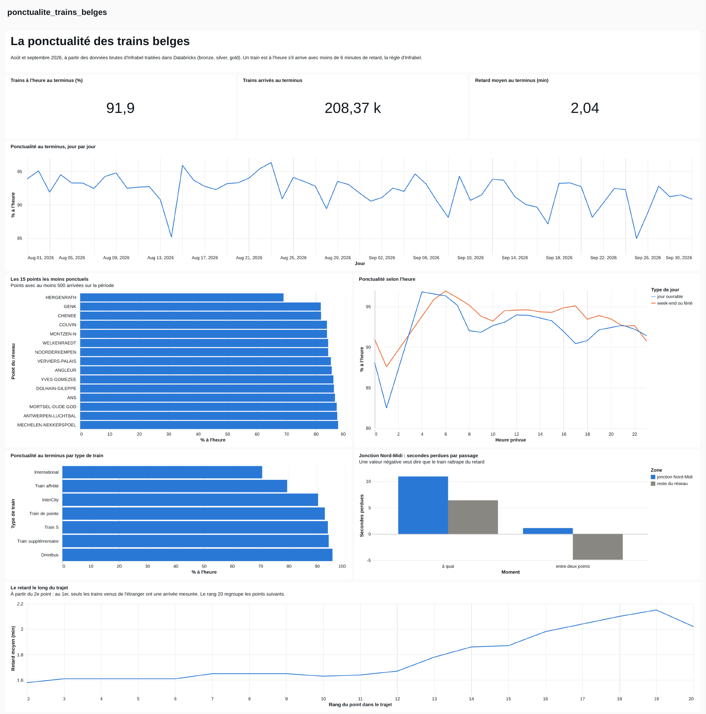
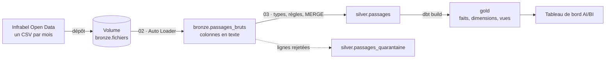
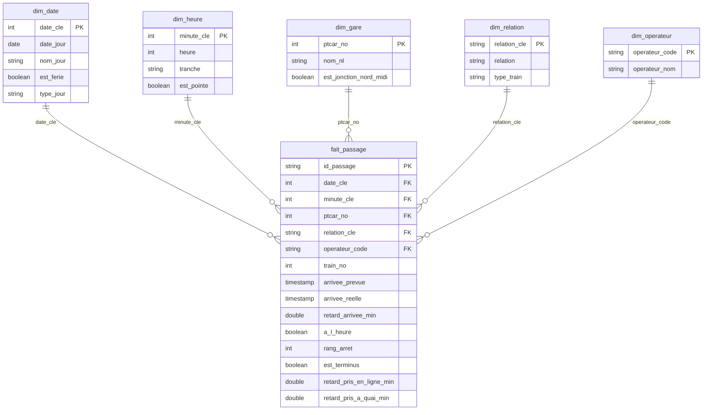
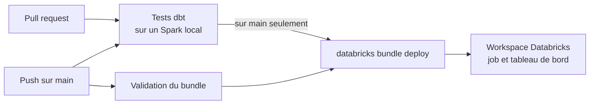

# Ponctualité des trains belges

[](https://github.com/AstreetM/infrabel-ponctualite/actions/workflows/ci-cd.yml)

Un pipeline de données sur Databricks qui transforme les fichiers bruts de ponctualité d'Infrabel en un modèle en étoile et un tableau de bord. Les données couvrent août et septembre 2026 : 4 051 748 passages d'un train à un point du réseau.

Le projet suit l'architecture médaillon. Le bronze charge les CSV avec Auto Loader, le silver type et contrôle les données en PySpark, le gold construit le modèle en étoile avec dbt. Un job Lakeflow enchaîne les trois couches dès qu'un nouveau fichier mensuel arrive. Tout le projet est décrit comme du code dans un bundle Databricks : GitHub Actions teste le gold à chaque pull request, puis le déploie sur le workspace à chaque push sur main.



## Ce que montrent les données

- **91,9 % des trains arrivent à leur terminus avec moins de 6 minutes de retard**, sur 208 365 trains : 92,8 % en août et 91,1 % en septembre. Le retard moyen au terminus est de 2,04 minutes.
- **Sur la jonction Nord-Midi, à Bruxelles, les trains perdent du temps.** 90,6 % des arrivées y sont à l'heure, contre 93,4 % sur le reste du réseau. Entre deux points, un train y perd 1 seconde en moyenne, alors qu'il en regagne 5 ailleurs. À quai, il perd 11 secondes, contre 6 ailleurs.
- **Huit des quinze points les moins ponctuels sont en province de Liège.** Le moins ponctuel, Hergenrath, juste avant la frontière allemande, n'a que 69 % d'arrivées à l'heure.
- **En semaine, la pointe du soir pèse plus que celle du matin.** Vers 17 h, la ponctualité descend sous 91 %, contre environ 95 % le week-end à la même heure.
- **Les trains internationaux sont les moins ponctuels** : environ 70 % d'arrivées à l'heure en fin de parcours belge, contre 95 % pour les omnibus.
- **Le retard grandit sur les longs trajets.** Il reste autour de 1,6 minute jusqu'au 12e point du trajet, puis dépasse 2 minutes à partir du 17e.

## Architecture



Le job `ponctualite_trains_belges` lance les notebooks 02 et 03, puis `dbt build` pour le gold. Il rafraîchit ensuite le tableau de bord et l'envoie en PDF par mail. Il démarre dès qu'un fichier arrive dans le volume, et prévient par mail en cas d'échec. Les notebooks tournent sur le calcul serverless, en mode standard : pour un traitement mensuel, quelques minutes de démarrage ne comptent pas, et ce mode consomme moins. dbt envoie ses requêtes à l'entrepôt SQL du workspace.

## Les données

- **Source** : [fichiers mensuels des données brutes de ponctualité](https://opendata.infrabel.be/explore/dataset/stiptheid-gegevens-maandelijksebestanden/information/), publiés par Infrabel sous licence CC0.
- **Contenu** : une ligne par passage d'un train à un point du réseau, avec les heures prévues et réelles d'arrivée et de départ, et les retards en secondes.
- **Format** : 22 colonnes, soit les 19 de la documentation plus `CIRC_TYP`, `OP1_COD` et `THOP1_COD`. Les dates s'écrivent `01AUG2026` et les heures `9:59:59`, sans zéro devant.
- **Volume** : 652,4 Mo de CSV pour août et septembre 2026, 642 points du réseau et 211 918 trains-jours.

## Bronze et silver, en PySpark

### 01 · Exploration

Le notebook lit les CSV sans rien écrire : profil de chaque colonne, formats de date et d'heure, contrôles de cohérence. Ce qu'il a trouvé a fixé les règles du silver :

- 47 clés en double avec un contenu différent, dont un train entier en deux versions ;
- 98 cas où un train passe deux fois au même point le même jour ;
- 20 206 arrivées le lendemain du départ ;
- 4 944 retards qui s'écartent des horaires, presque tous d'une ou deux minutes ;
- 404 retards de plus de 3 heures, dont 11 h 27 pour l'European Sleeper n° 474 du 4 août.

### 02 · Bronze

- Auto Loader, avec le déclencheur `availableNow`, ne lit que les fichiers nouveaux, puis s'arrête.
- Les colonnes restent en texte, telles que dans les CSV. S'ajoutent le nom du fichier, sa date de modification et l'heure du chargement.
- Un contrôle compare, fichier par fichier, le nombre de lignes du CSV et celui de la table. Le moindre écart arrête le job.
- En Delta, les 652,4 Mo de CSV ne pèsent plus que 47,9 Mo, soit 13,6 fois moins.

### 03 · Silver

- `try_cast` et `try_to_timestamp` donnent les types : en mode ANSI, une valeur illisible devient `NULL` au lieu de faire échouer tout le traitement.
- Une ligne qui enfreint une règle part en quarantaine avec ses raisons, au lieu d'être supprimée : date, train, point ou heure illisible, aucun horaire prévu, avance de plus de 30 minutes, valeur hors schéma.
- La clé d'un passage réunit la date, le train, le point et les heures prévues. Pour les doublons, la ligne gardée est la plus complète, puis celle qui a un vrai retard mesuré, puis la plus récente.
- Le traitement est incrémental : un journal retient le dernier chargement bronze traité, et les écritures passent par des `MERGE`. Relancer le notebook ne crée jamais de doublon.
- Résultat : 4 051 681 lignes valides et 67 en quarantaine, soit 47 doublons de clé et 20 avances de plus de 30 minutes.

## Le gold, avec dbt

Le dossier `dbt/` contient un projet dbt qui construit le gold à partir de `silver.passages`. Il remplace l'ancien notebook SQL `04_gold.sql` : sur les données de test, les 13 tables et vues qu'il produit sont identiques à celles du notebook, ligne pour ligne.

- **Un modèle en étoile au grain du passage** : un train, à un point, un jour. Les dimensions et le fait sont des tables Delta, et les sept vues du tableau de bord sont des vues.
- **Des fonctions de fenêtre sur chaque trajet** : rang du point, origine, terminus, retard pris entre deux points et à quai.
- **Des clés calculées à un seul endroit.** Les macros `cle_date` et `cle_relation` servent au fait comme aux dimensions : une jointure ne peut pas échouer parce qu'un des deux côtés aurait changé sa formule.
- **Les jours fériés dans un seed.** `seeds/jours_feries.csv` couvre 2025 et 2026. Pour une autre année, il suffit d'ajouter des lignes au fichier, sans toucher au SQL.
- **46 tests de données** : clés uniques et non vides, lien entre le fait et chaque dimension, valeurs attendues, un seul terminus par train et par jour, autant de passages dans le fait que dans le silver. Un test en échec arrête le job avant le tableau de bord, comme le faisaient les contrôles `raise_error` de l'ancien notebook. Un dernier test avertit, sans bloquer, quand un code de train inconnu apparaît.
- **5 tests unitaires** sur quelques lignes écrites à la main : le classement des arrêts et le retard pris en route, un train de nuit qui arrive après minuit, les week-ends et les fériés, les types de train, et la courbe du retard qui laisse dehors l'arrivée d'un train venu de l'étranger.
- **La documentation dans le catalogue** : les descriptions des fichiers YAML deviennent les commentaires des tables et des colonnes dans Unity Catalog.



## Le tableau de bord

Le bundle le déploie à partir de `dashboard/ponctualite_trains_belges.lvdash.json`, l'export du tableau de bord publié. Il répond aux cinq questions du projet :

1. Quelle est la ponctualité au terminus, jour après jour ?
2. Quels points du réseau et quels types de train sont les moins ponctuels ?
3. Comment la ponctualité varie-t-elle selon l'heure et le type de jour ?
4. Comment le retard évolue-t-il le long d'un trajet ?
5. La jonction Nord-Midi fait-elle perdre du temps aux trains ?

## CI/CD



Le fichier `databricks.yml` et le dossier `resources/` décrivent le projet comme du code, avec les Declarative Automation Bundles de Databricks (anciennement Databricks Asset Bundles) : le job, ses quatre tâches, son déclencheur et le tableau de bord. Le workflow `.github/workflows/ci-cd.yml` s'en sert en trois étapes.

1. **Les tests dbt.** À chaque pull request et à chaque push sur main, `ci/tester_dbt.py` génère un silver d'exemple dans un Spark local, puis lance `dbt build` : les modèles, les 46 tests de données et les 5 tests unitaires tournent sans Databricks. Le silver d'exemple couvre six jours d'août 2026, dont le 15 août, douze points du réseau, des trains IC, L, S et P, un train de nuit et un Eurostar venu de Paris.
2. **La validation du bundle.** La CLI Databricks vérifie la configuration auprès du workspace.
3. **Le déploiement.** Après un push sur main, `databricks bundle deploy` crée ou met à jour le job et le tableau de bord.

Les deux dernières étapes ont besoin de trois réglages dans le dépôt GitHub, sous Settings, Secrets and variables, Actions :

| Type | Nom | Valeur |
| --- | --- | --- |
| Variable | `DATABRICKS_HOST` | l'adresse du workspace, par exemple `https://dbc-xxxx.cloud.databricks.com` |
| Variable | `DATABRICKS_WAREHOUSE_ID` | l'identifiant de l'entrepôt SQL |
| Secret | `DATABRICKS_TOKEN` | un jeton d'accès personnel |

Sans ces réglages, les tests dbt tournent quand même, et les deux autres étapes sont sautées.

## Reproduire le projet

1. Créer un compte [Databricks Free Edition](https://docs.databricks.com/aws/en/getting-started/free-edition).
2. Créer les schémas et le volume :

   ```sql
   CREATE SCHEMA IF NOT EXISTS workspace.bronze;
   CREATE SCHEMA IF NOT EXISTS workspace.silver;
   CREATE SCHEMA IF NOT EXISTS workspace.gold;
   CREATE VOLUME IF NOT EXISTS workspace.bronze.fichiers;
   ```

3. Télécharger des fichiers mensuels depuis l'onglet « Tableau » du jeu de données d'Infrabel, et les déposer dans le volume `bronze.fichiers`.
4. Déployer le projet, au choix :
   - depuis GitHub : forker le dépôt, ajouter les trois réglages ci-dessus, puis lancer le workflow CI/CD depuis l'onglet Actions ;
   - depuis un poste, avec la CLI Databricks : `databricks bundle deploy --var="warehouse_id=<identifiant>"`.
5. Lancer le job depuis l'onglet Jobs & Pipelines. Ensuite, il démarre seul à chaque nouveau fichier.

Pour tester le gold en local, sans Databricks, avec Python 3.12 et Java 17 :

```bash
pip install -r ci/requirements.txt
python ci/tester_dbt.py
```

## Limites

- La version gratuite de Databricks limite l'accès à Internet : les fichiers d'Infrabel sont téléchargés à la main, et leur dépôt dans le volume lance le job.
- La version gratuite n'a pas de console de compte : le déploiement s'authentifie avec un jeton personnel. En entreprise, ce serait un compte de service et la fédération d'identité de GitHub (OIDC), sans secret à stocker.
- Les tests unitaires dbt tournent dans GitHub Actions, pas dans le job : ils vérifient la logique du code, pas les données du mois.
- Pour un train qui quitte la Belgique, le terminus des données est son dernier point belge.
- Les noms des points sont en néerlandais, comme dans la source.
- La liste des jours fériés couvre 2025 et 2026.

## Structure du dépôt

```
databricks.yml          le bundle : variables et cible de déploiement
resources/
  ponctualite_trains_belges.job.yml        le job et ses quatre tâches
  ponctualite_trains_belges.dashboard.yml  le tableau de bord
notebooks/
  01_exploration.py     exploration en PySpark
  02_bronze.py          chargement brut avec Auto Loader
  03_silver.py          types, qualité, quarantaine et MERGE
dbt/
  models/               dimensions, fait et vues, avec leurs tests
  seeds/                jours fériés belges
  macros/               clés partagées entre le fait et les dimensions
  tests/                tests sur plusieurs tables
  profiles/             profils pour lancer dbt hors du job
dashboard/
  ponctualite_trains_belges.lvdash.json
ci/
  tester_dbt.py         silver d'exemple et dbt build sur un Spark local
.github/workflows/
  ci-cd.yml             tests, validation et déploiement
docs/
  tableau_de_bord.png
```

Projet réalisé par Astrit Mustafa. Portfolio : [astreetm.github.io](https://astreetm.github.io).
